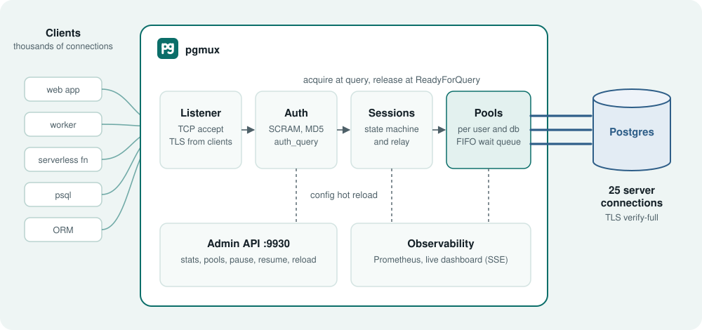
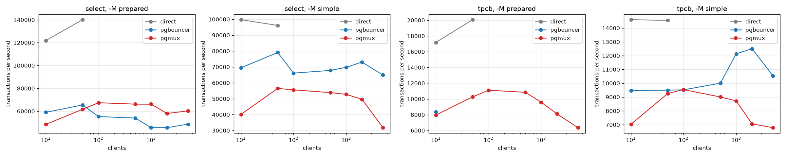
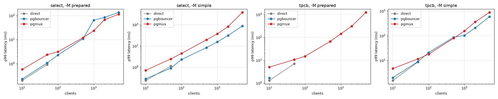

<p align="center">
  
</p>

<h1 align="center">pgmux</h1>

<p align="center">
  <b>A Postgres connection pooler in Go.</b><br>
  Thousands of clients share a few server connections, and your apps need no changes.
</p>

<p align="center">
  <a href="https://github.com/sanjeepan23/pgmux/actions/workflows/ci.yml"></a>
  <a href="https://github.com/sanjeepan23/pgmux/releases"></a>
  
  
  <a href="LICENSE"></a>
</p>

<p align="center">
  <a href="https://sanjeepan23.github.io/pgmux/">Website</a> ·
  <a href="#-quick-start">Quick start</a> ·
  <a href="#-benchmarks">Benchmarks</a> ·
  <a href="https://github.com/sanjeepan23/pgmux/releases">Releases</a>
</p>

## ✨ Features

- 🔀 **Session and transaction pooling** for Postgres 14 to 17.
- 📝 **Prepared statements in transaction mode**, with no client changes.
- 🔐 **SCRAM-SHA-256 and MD5 authentication**, with a userlist file or an `auth_query`.
- 🔒 **TLS on both sides**, including `verify-full` to Postgres.
- 📈 **Prometheus metrics**, an admin HTTP API, a live dashboard and a Grafana dashboard.
- ♻️ **Config hot reload**, graceful shutdown and cancel requests.
- 🧪 **Tested with real drivers** in Go, Python, TypeScript and Java.

## 🚀 Quick start

You need Go 1.26, Docker and `psql`.

```sh
make compose-up        # Postgres 16 with TLS and seed data
make run               # pgmux on 127.0.0.1:6432, admin API on 127.0.0.1:9930
PGPASSWORD=app psql "host=127.0.0.1 port=6432 user=app dbname=appdb" -c "select count(*) from items"
```

Open http://127.0.0.1:9930/ for the dashboard after `make dashboard`.

To run pgmux in Docker as well:

```sh
docker compose -f deploy/docker-compose.yml --profile pgmux up -d --build
```

## 📦 Install

Download a binary for Linux or macOS from the
[releases page](https://github.com/sanjeepan23/pgmux/releases). Each archive also has the
dashboard in `dashboard/dist`. Set `dashboard_dir` to that path to serve it.

Or use the Docker image for `linux/amd64` and `linux/arm64`:

```sh
docker run -p 6432:6432 -p 9930:9930 -v "$PWD/pgmux.yaml:/etc/pgmux/pgmux.yaml" ghcr.io/sanjeepan23/pgmux:latest
```

The image has the dashboard in `/usr/share/pgmux/dashboard`.

## 🏗️ Architecture

<p align="center">
  
</p>

Each client connection has one goroutine. It reads client messages and forwards them to a server
connection. While a server connection is attached, a relay goroutine forwards the server messages to
the client.

The session state machine is the core. It keeps a queue of the requests that wait for a response.
Each server message completes the request at the head of the queue. In transaction mode, the relay
releases the server connection when all of these are true:

- the server sent `ReadyForQuery` with status `I` (idle),
- no request waits for a response,
- the client sent no extended-protocol messages after its last `Sync`.

So a pipeline of queries, a `COPY`, or an open transaction keeps its server connection.

### Prepared statements in transaction mode

A client prepares a statement on one server, but its next transaction can run on another server.
pgmux handles this as follows:

1. pgmux gives each statement a server-side name from a hash of its query text and parameter types.
   Clients that prepare the same query share one statement on each server.
2. Each server connection records which statements it has. Each client records its own names.
3. Before a `Bind` or `Describe`, pgmux sends the `Parse` again if the current server lacks the
   statement. pgmux drops the response to that `Parse`, so the client does not see it.
4. When the server already has the statement, pgmux answers the client's `Parse` itself.
5. When a client sends `Parse` or `Close` while it has no server and no open transaction, pgmux
   answers without a server. This stops a client that prepares synchronously from deadlocking the
   pool. The trade-off: a syntax error in that statement shows at `Bind` time and not at `Parse` time.

### Server parameters

pgmux keeps the values that each client expects for `application_name`, `client_encoding`,
`DateStyle`, `IntervalStyle`, `TimeZone` and `standard_conforming_strings`. When a client lands on a
server with different values, pgmux sends `SET` first, in the same write as the client's query.
So `SET TimeZone` works in transaction mode, and one client's value never leaks to another client.

### Session state that does not work in transaction mode

pgmux logs a warning and counts `pgmux_session_feature_warnings_total` for a non-`LOCAL` `SET` of
other parameters, `PREPARE`, temporary tables, session advisory locks and `WITH HOLD` cursors.
pgmux rejects `LISTEN` in transaction mode with a clear error. `LISTEN` works in session mode.

## ⚙️ Configuration

See [pgmux.example.yaml](pgmux.example.yaml) for every setting and its default. pgmux reloads the
config file and the userlist when they change, on `SIGHUP`, and on `POST /reload`. Pool sizes,
timeouts, users and TLS certificates change without a restart. Listen addresses need a restart.

The userlist uses the PgBouncer format: `"user" "secret"`. The secret can be a plaintext password,
an MD5 hash, or a SCRAM secret. pgmux needs one of these to log in to Postgres:

- a plaintext password or an MD5 hash, or
- a SCRAM secret. Then pgmux reuses the SCRAM proof of the first client that logs in, so no
  plaintext password is on disk. `auth_query` uses this method too.

## 🛠️ Admin API

| Endpoint | Description |
| --- | --- |
| `GET /stats` | Totals for clients, servers, queries, transactions and errors |
| `GET /pools` | One entry per pool |
| `GET /events` | Server-Sent Events with stats and pools, once a second |
| `GET /metrics` | Prometheus metrics |
| `POST /pause?user=&db=&timeout=` | Stop handing out servers and wait for active ones to return |
| `POST /resume?user=&db=` | Hand out servers again |
| `POST /reload` | Load the config files again |
| `GET /healthz` | Liveness |
| `GET /debug/pprof/` | Go profiling (off when `admin_read_only` is true) |

The Grafana dashboard is in [deploy/grafana](deploy/grafana).

## 🧩 Compatibility

The [client suites](clients/) run the same nine scenarios in four languages, in both pool modes.
The scenarios are CRUD, transactions, prepared statements, 200 concurrent workers, cancel, COPY,
1M-row results, LISTEN/NOTIFY and TLS. CI runs each suite against Postgres 14 and 17.

| Language | Drivers and ORMs | Transaction mode | Session mode |
| --- | --- | --- | --- |
| Go | pgx v5 (cache statement, simple protocol), pgx `database/sql`, lib/pq | ✅ | ✅ |
| Python | psycopg 3, asyncpg, SQLAlchemy 2 | ✅ | ✅ |
| TypeScript | node-postgres, postgres.js (pipelined), Prisma | ✅ | ✅ |
| Java | pgjdbc (`prepareThreshold` 0, 1 and 5), HikariCP | ✅ | ✅ |

Prisma works without the `pgbouncer=true` flag.

## 📊 Benchmarks

One machine (Apple M3 Pro, Docker with 10 CPUs) runs Postgres 16 on 4 CPUs, the pooler on 2 CPUs
and pgbench on 4 CPUs. Each point is the median of 3 runs of 60 s after a 15 s warm-up. Both poolers
use transaction mode with 25 server connections. Direct Postgres has `max_connections = 100`, so it
fails from 100 clients on.




| Workload | Clients | PgBouncer 1.24 | pgmux | pgmux p99 |
| --- | --- | --- | --- | --- |
| `select -M prepared` | 10 | 59,040 TPS | 48,478 TPS | 0.6 ms |
| `select -M prepared` | 1,000 | 45,609 TPS | 66,177 TPS | 23 ms |
| `select -M simple` | 10 | 69,431 TPS | 40,132 TPS | 0.7 ms |
| `select -M simple` | 1,000 | 69,755 TPS | 52,767 TPS | 37 ms |
| `tpcb -M simple` | 1,000 | 12,130 TPS | 8,722 TPS | 156 ms |
| `tpcb -M prepared` | 1,000 | stalls | 9,587 TPS | 144 ms |

What the numbers show:

- With prepared statements and 100 or more clients, pgmux is 20% to 45% faster than PgBouncer.
- With the simple protocol, pgmux is slower than PgBouncer: by 24% at 1,000 clients and by 42% at 10 clients.
- PgBouncer 1.24.1 stalls on `tpcb -M prepared` from 50 clients on. All its server connections wait
  in a transaction after `BEGIN`, and clients time out. pgmux has no errors and drops no clients at any point.
- pgmux uses two CPU cores where PgBouncer uses one. pgmux uses about 80 KB of memory per client
  (430 MB at 5,000 clients). PgBouncer uses 42 MB.

The scripts, machine specs and raw results are in [bench/](bench/). Direct and PgBouncer come from the
first run, and pgmux from a second run after a fix. Both runs used the same settings.

## 🧭 Design decisions and trade-offs

- **pgproto3 for message types, own framing.** pgmux reads raw messages and forwards most of them
  unchanged. It decodes only the messages that it must inspect or change.
- **A persistent reader goroutine per server connection.** The relay never has to interrupt a
  blocked read, so releasing a connection is a channel operation.
- **Request queue instead of byte counting.** Matching each server response to a queued request
  makes pipelining, error skipping and injected messages correct by construction.
- **Content-addressed statement names.** Clients share server statements, and two clients cannot
  collide on a name. The cost is a hash per `Parse`.
- **Writes never happen under the session lock.** A blocked write to a slow peer cannot stall the
  relay, so a pipeline cannot deadlock inside pgmux.
- **FIFO wait queue.** A new client cannot take a connection before a client that waits already.

## ⚠️ Limitations

- No statement-level pooling, no clustering of pgmux itself, no query routing.
- `PREPARE` and `EXECUTE` in SQL do not move between servers in transaction mode.
- Server statements stay until the connection reaches `max_lifetime`. An app that prepares many
  unique queries uses more server memory.
- Protocol 3.2 (Postgres 18) clients fall back to 3.0 through `NegotiateProtocolVersion`.
- No channel binding (`SCRAM-SHA-256-PLUS`).
- Each client uses about 80 KB of memory, which is more than PgBouncer.
- With the simple protocol, pgmux has lower throughput than PgBouncer.

## 🧑‍💻 Development

```sh
make test          # unit tests
make race          # unit tests with the race detector
make compose-up    # Postgres for the end-to-end tests
make e2e           # end-to-end tests with real Postgres, pgx and the race detector
make fuzz          # Go native fuzzing of the parsers
make lint          # golangci-lint
make clients       # all client suites (see clients/README.md)
make bench         # full benchmark (see bench/README.md)
```

| Path | Contents |
| --- | --- |
| `cmd/pgmux` | Flags, logging and signal handling |
| `internal/app` | Wires the components together |
| `internal/config` | YAML config and hot reload |
| `internal/listener` | TCP accept loop and graceful shutdown |
| `internal/protocol` | Message framing on top of pgproto3 |
| `internal/auth` | SCRAM-SHA-256, MD5 and the userlist |
| `internal/pool` | Server connections, the dialer and the pools |
| `internal/session` | Startup, the client state machine and cancel requests |
| `internal/prepared` | Statement names for transaction mode |
| `internal/metrics` | Prometheus collectors |
| `internal/admin` | Admin HTTP API and event stream |
| `test/e2e` | End-to-end tests |
| `dashboard` | React and Vite live dashboard |
| `clients` | Compatibility suites for Go, Python, TypeScript and Java |
| `bench` | pgbench runner, connection-churn generator and plots |
| `deploy` | Docker, Compose, Kubernetes and Grafana files |

## 🖥️ Dashboard

The admin API serves a live dashboard. It shows clients, server connections, throughput and pool
saturation, and it updates once a second.


## 📄 License

Apache License 2.0. See [LICENSE](LICENSE).
