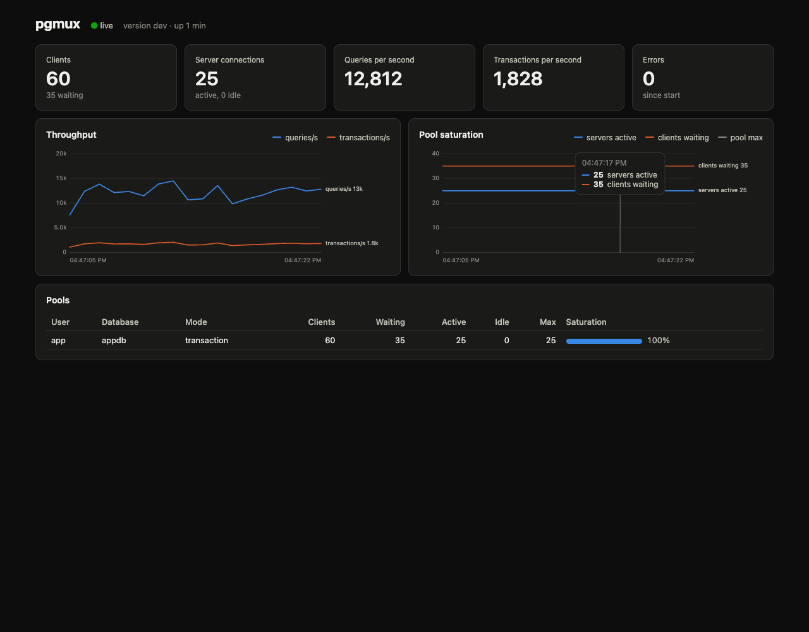
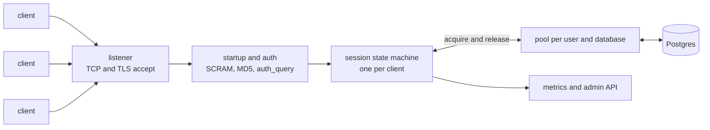

# pgmux

pgmux is a Postgres connection pooler in Go. It speaks the Postgres wire protocol, so thousands of
client connections can share a small pool of real server connections.

- Session and transaction pooling, for Postgres 14 to 17.
- SCRAM-SHA-256 and MD5 authentication, with a userlist file or an `auth_query`.
- TLS from clients and to Postgres, including `verify-full`.
- Prepared statements in transaction mode, with no client changes.
- Prometheus metrics, an admin HTTP API, a live dashboard, and a Grafana dashboard.
- Config hot reload, graceful shutdown, and cancel request support.



## Quick start

You need Go 1.26, Docker and `psql`.

```sh
make compose-up        # Postgres 16 with TLS and seed data
make run               # pgmux on 127.0.0.1:6432, admin API on 127.0.0.1:9930
PGPASSWORD=app psql "host=127.0.0.1 port=6432 user=app dbname=appdb" -c "select count(*) from items"
```

Open http://127.0.0.1:9930/ for the dashboard after `make dashboard`.

To run pgmux in Docker as well:

```sh
docker compose -f deploy/docker-compose.yml --profile pgmux up -d --build
```

## Install

Download a binary for Linux or macOS from the
[releases page](https://github.com/sanjeepan23/pgmux/releases). Each archive also has the
dashboard in `dashboard/dist`. Set `dashboard_dir` to that path to serve it.

Or use the Docker image for `linux/amd64` and `linux/arm64`:

```sh
docker run -p 6432:6432 -p 9930:9930 -v "$PWD/pgmux.yaml:/etc/pgmux/pgmux.yaml" ghcr.io/sanjeepan23/pgmux:latest
```

The image has the dashboard in `/usr/share/pgmux/dashboard`.

## Architecture



Each client connection has one goroutine. It reads client messages and forwards them to a server
connection. While a server connection is attached, a relay goroutine forwards the server messages to
the client.

The session state machine is the core. It keeps a queue of the requests that wait for a response.
Each server message completes the request at the head of the queue. In transaction mode, the relay
releases the server connection when all of these are true:

- the server sent `ReadyForQuery` with status `I` (idle),
- no request waits for a response,
- the client sent no extended-protocol messages after its last `Sync`.

So a pipeline of queries, a `COPY`, or an open transaction keeps its server connection.

### Prepared statements in transaction mode

A client prepares a statement on one server, but its next transaction can run on another server.
pgmux handles this as follows:

1. pgmux gives each statement a server-side name from a hash of its query text and parameter types.
   Clients that prepare the same query share one statement on each server.
2. Each server connection records which statements it has. Each client records its own names.
3. Before a `Bind` or `Describe`, pgmux sends the `Parse` again if the current server lacks the
   statement. pgmux drops the response to that `Parse`, so the client does not see it.
4. When the server already has the statement, pgmux answers the client's `Parse` itself.
5. When a client sends `Parse` or `Close` while it has no server and no open transaction, pgmux
   answers without a server. This stops a client that prepares synchronously from deadlocking the
   pool. The trade-off: a syntax error in that statement shows at `Bind` time and not at `Parse` time.

### Server parameters

pgmux keeps the values that each client expects for `application_name`, `client_encoding`,
`DateStyle`, `IntervalStyle`, `TimeZone` and `standard_conforming_strings`. When a client lands on a
server with different values, pgmux sends `SET` first, in the same write as the client's query.
So `SET TimeZone` works in transaction mode, and one client's value never leaks to another client.

### Session state that does not work in transaction mode

pgmux logs a warning and counts `pgmux_session_feature_warnings_total` for a non-`LOCAL` `SET` of
other parameters, `PREPARE`, temporary tables, session advisory locks and `WITH HOLD` cursors.
pgmux rejects `LISTEN` in transaction mode with a clear error. `LISTEN` works in session mode.

## Configuration

See [pgmux.example.yaml](pgmux.example.yaml) for every setting and its default. pgmux reloads the
config file and the userlist when they change, on `SIGHUP`, and on `POST /reload`. Pool sizes,
timeouts, users and TLS certificates change without a restart. Listen addresses need a restart.

The userlist uses the PgBouncer format: `"user" "secret"`. The secret can be a plaintext password,
an MD5 hash, or a SCRAM secret. pgmux needs one of these to log in to Postgres:

- a plaintext password or an MD5 hash, or
- a SCRAM secret. Then pgmux reuses the SCRAM proof of the first client that logs in, so no
  plaintext password is on disk. `auth_query` uses this method too.

## Admin API

| Endpoint | Description |
| --- | --- |
| `GET /stats` | Totals for clients, servers, queries, transactions and errors |
| `GET /pools` | One entry per pool |
| `GET /events` | Server-Sent Events with stats and pools, once a second |
| `GET /metrics` | Prometheus metrics |
| `POST /pause?user=&db=&timeout=` | Stop handing out servers and wait for active ones to return |
| `POST /resume?user=&db=` | Hand out servers again |
| `POST /reload` | Load the config files again |
| `GET /healthz` | Liveness |
| `GET /debug/pprof/` | Go profiling (off when `admin_read_only` is true) |

The Grafana dashboard is in [deploy/grafana](deploy/grafana).

